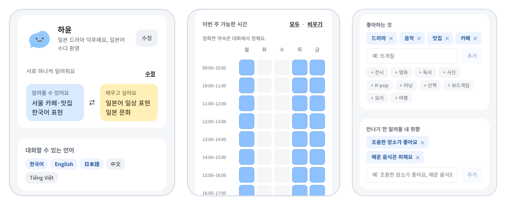
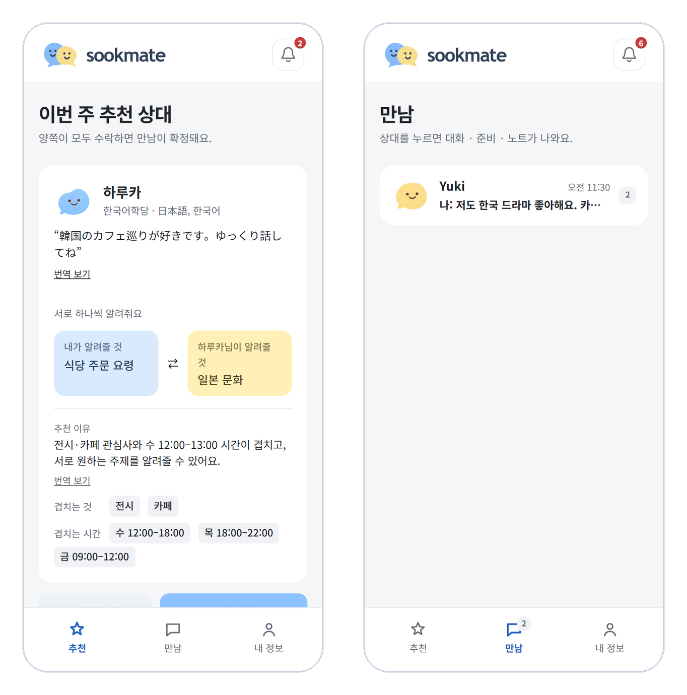
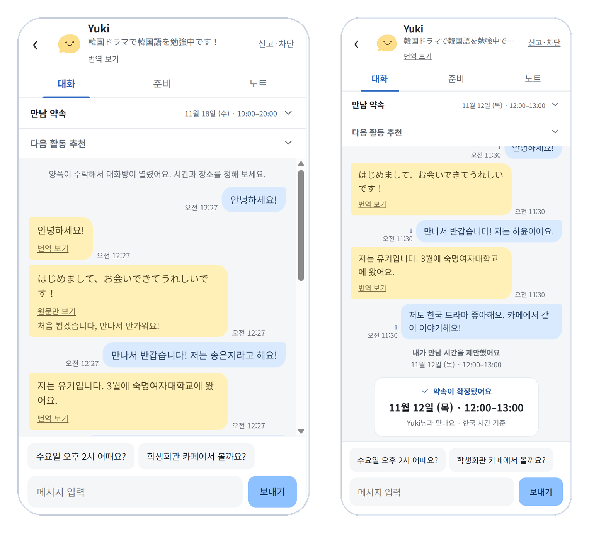
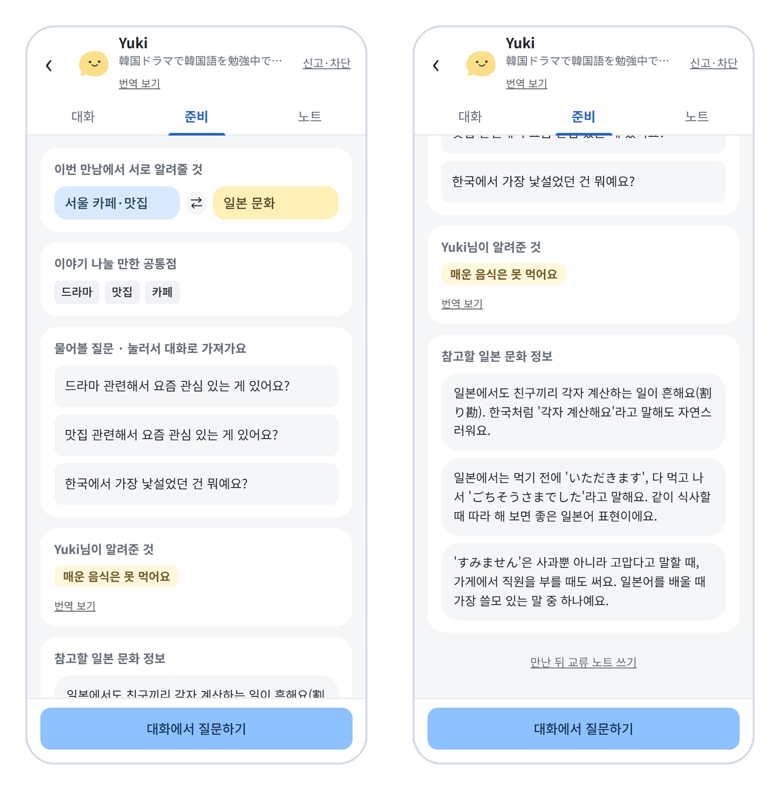
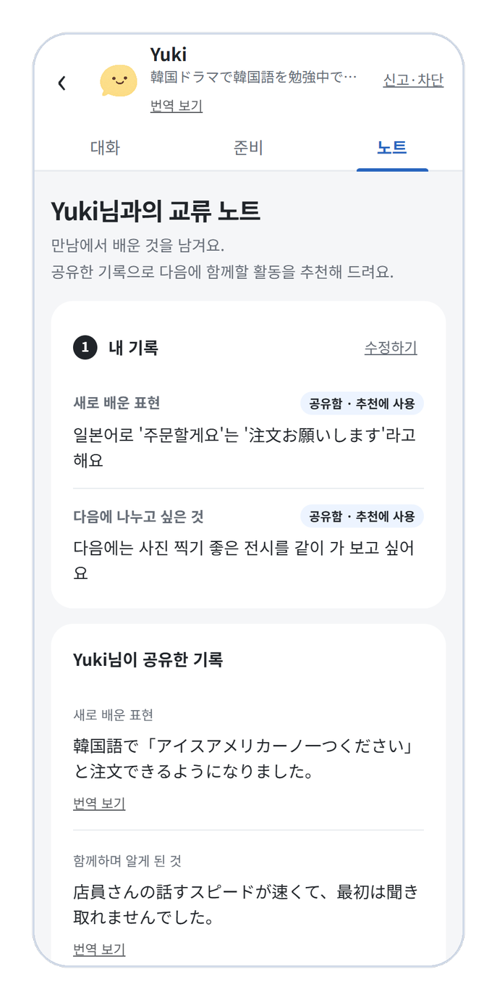
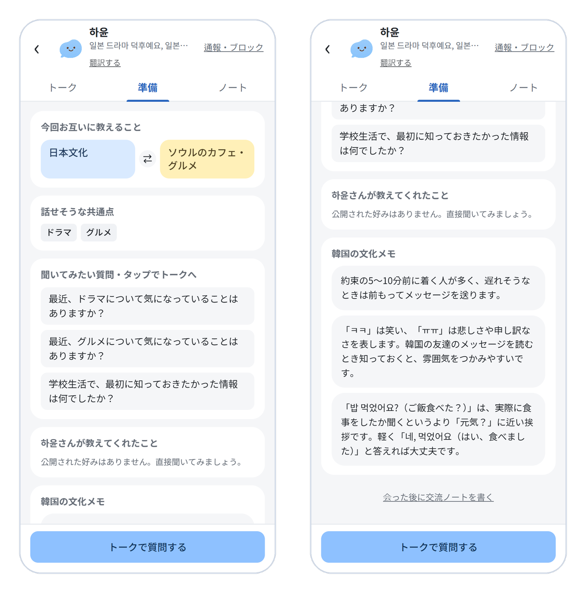

# SOOKMATE (숙메이트)


**같은 캠퍼스, 이제는 함께 살아요. 국내 학생과 유학생의 가벼운 첫 만남, 그리고 서로 하나씩 알려주는 교류.**

프로그램에 참여하지 않아도, 정기 활동을 약속하지 않아도 괜찮습니다. 관심사·가능 시간·언어·알려줄 것과 배우고 싶은 것을 입력하면 AI가 이유와 함께 상대를 추천하고, 양쪽이 수락하면 1:1 대화방이 열립니다. 만나기 전에는 브리핑을 보고, 만난 뒤에는 교류 노트를 남기면 다음에 함께할 활동이 이어집니다. SWAITHON 예선 출품작(팀 숙덕숙덕)입니다.

프로필 입력 → AI 추천 → 양측 수락 → 1:1 대화방·만남 약속 → 만나기 전 브리핑 → 교류 노트 → 다음 활동 추천

- 대상: 숙명여대 국내 학생 · 유학생 (숙명 메일로 가입)
- 상태: 합성 프로필 50명으로 전체 이용 흐름을 시연할 수 있는 프로토타입

## 서비스 화면

### 1. 프로필 설정


알려줄 수 있어요 ⇄ 배우고 싶어요, 대화할 수 있는 언어, 이번 주 가능한 시간(시간 단위 표), 좋아하는 것, 만나기 전 알려둘 취향을 한 화면에서 입력합니다.

### 2. 추천과 수락


추천 이유, 겹치는 관심사와 시간, 서로 알려줄 것을 보고 수락합니다. 양쪽이 모두 수락하면 만남이 확정됩니다.

### 3. 대화방과 만남 약속


상대 메시지는 **번역 보기**로 내 언어로 읽을 수 있고, 두 사람의 공통 가능 시간 안에서 약속을 제안합니다. 상대가 수락하면 채팅에 **약속 확정 카드**가 생깁니다.

### 4. 만나기 전 브리핑


서로 알려줄 것, 이야기 나눌 만한 공통점, 물어볼 질문(눌러서 대화로 가져가기), 상대가 직접 쓴 취향, 참고할 문화 정보를 보여줍니다.

### 5. 교류 노트와 다음 활동


새로 배운 표현, 함께하며 알게 된 것, 다음에 나누고 싶은 것을 짧게 남기고 항목마다 공유 여부를 고릅니다. 공유한 기록으로 다음에 함께할 활동을 추천받고, 채팅으로 바로 제안합니다.

### 6. 5개 언어 화면


한국어 · English · 日本語 · 中文 · Tiếng Việt. 브리핑의 정해진 문구는 AI 없이도 내 언어로 보입니다.

## 주요 기능

| 영역 | 기능 |
|---|---|
| 가입·프로필 | 숙명 메일 인증 코드로 가입, 비밀번호 로그인·비밀번호 찾기, 이름·한 줄 소개, 알려줄 것·배우고 싶은 것, 대화 언어, 가능 시간, 관심사, 만나기 전 알려둘 취향, 국적(선택) |
| 추천·배정 | 필수 조건 필터 → 점수 계산 → OR-Tools 전체 최적 배정, 1인당 주간 만남 상한, 추천 이유·겹치는 시간·비슷한 관심사(`음악 ≈ music`) 표시 |
| 수락·재배정 | 추천 후 48시간 안에 양쪽 수락, 거절·취소·기한 만료 시 자리를 풀고 다시 배정, 추천 만료 예약 작업 |
| 대화방 | 1:1 텍스트 대화(WebSocket), 읽음 표시, 번역 보기, 신고·차단 |
| 만남 약속 | 공통 가능 시간 안에서 제안 → 수락 → 확정, 거절·취소, 채팅 속 약속 카드, 다른 만남과 겹치는 시간 제외 |
| 브리핑 | 상대 취향(쓴 그대로), 공통점, 물어볼 질문, 나라별 문화 참고 정보(읽는 사람에 맞춰 상대 나라 또는 한국 자료) |
| 교류 노트 | 항목별 공유 선택, 상대가 공유한 기록 보기, 기록 수정·삭제 |
| 다음 활동 추천 | 공유 노트 분석 → 자료 검색(활동 자료집·위키백과) → 25분 활동 생성(출처 표시), 채팅으로 제안, 자료 없는 추천과 나란히 비교·평가 |
| 알림 | 앱 상단 종 아이콘과 알림 패널(추천 도착·수락·확정·거절·취소·만료·새 메시지), 안 읽은 수, 눌러서 해당 화면으로 이동 |
| 다국어 | 화면 문구 5개 언어, 소개글·추천 이유·메시지 번역 |

### 신뢰성 설계

- 추천 이유는 **실제로 겹친 항목**(관심사·시간)만으로 만들고, 없는 근거는 쓰지 않습니다.
- 상대가 쓴 **개인 취향은 쓴 그대로** 보여주며 문화 일반 정보보다 우선합니다. 국적으로 성향을 단정하지 않고 "~하는 경우가 많아요"처럼 일반 안내로만 말합니다.
- 문화 정보·활동 단계에는 **출처**를 붙이고, 근거 자료가 없으면 질문만 보여줍니다.
- LLM 결과는 서버에서 형식·출처를 검사하고, 실패하면 **기본 카드(fallback)** 를 보여줍니다. 숨기지 않고 어떤 언어·방식으로 보여주는지 표시합니다.
- 외부 AI에는 이름·연락처 없이 필요한 텍스트(분석에서 걸러진 짧은 키워드)만 보냅니다.
- 대화방은 양쪽이 수락한 뒤에만 열리고 연락처를 공개하지 않습니다. 교류 노트는 기본 비공개이며 작성자가 고른 항목만 상대에게 보입니다.
- 국적은 선택 입력이며 점수에 쓰지 않습니다.

## AI 설계

### 매칭

| 단계 | 내용 |
|---|---|
| 1. 필터 | 서로 다른 집단, 공통 가능 시간, 공통 대화 언어 1개 이상, 차단 아님 |
| 2. 점수 | `S = 0.35·I + 0.30·T + 0.15·L + 0.20·R` — I 관심사 유사도, T 공통 시간 비율, L 언어 충족도, R 양방향 적합도(알려줄 것 ⇄ 배우고 싶은 것). 국적·학과는 쓰지 않음 |
| 3. 배정 | OR-Tools 최소비용 흐름으로 매칭 수를 먼저 최대화하고, 같은 수 안에서 총점을 높임 (1인당 주간 상한 2) |
| 4. 수락·재배정 | 추천 후 48시간 안에 양쪽 수락, 거절·취소·만료 시 재배정, 동시 수락에도 상한 유지 |

합성 프로필 50명 시험 배정(글자 n-gram 기준)에서 32쌍이 배정되고 시간·언어 불일치와 상한 초과는 0건, 평균 매칭 점수는 0.70이었습니다. 가짜 프로필이라 경향 확인용입니다.

### 다국어 임베딩

서로 다른 언어로 쓴 관심사도 같은 뜻이면 가깝게 보도록 `embed()` 한 함수로 방식을 바꿔 쓸 수 있습니다.

| 방식 | 설명 |
|---|---|
| 글자 n-gram (기본) | 글자 2·3개 조각으로 벡터를 만듭니다. 설치·다운로드가 필요 없어 항상 동작합니다. |
| 다국어 모델 `BAAI/bge-m3` (선택) | 문장의 뜻을 벡터로 만듭니다. 한·영·일·중·베 등 다른 언어도 같은 뜻이면 가까워집니다. |

- 모델의 코사인 값은 좁은 구간에 몰려 있어 평가 스크립트로 정한 구간(0.6~0.8)을 0~1로 늘려 씁니다.
- 두 목록의 유사도는 "각 항목 → 상대 목록에서 가장 비슷한 것"을 양방향으로 평균해 구하므로 순서와 개수가 달라도 같습니다.
- 모델을 불러오지 못하면 **자동으로 n-gram으로 대체**합니다.
- 검증: 14개 개념을 8개 언어로 적은 정답 세트에서 글자 n-gram의 항목 구분력(AUC)은 **0.502**로 우연 수준이었습니다. 언어가 다르면 같은 뜻도 구분하지 못하므로 다국어 모델을 쓰도록 설계했습니다. (몽골·미얀마·네팔어 표현은 원어민 검수 전)
- 임베딩이 쓰이는 곳: 관심사 유사도(I), 알려줄 것 ⇄ 배울 것(R), 비슷한 관심사 표시, 문화 브리핑 검색, 활동 자료집 검색

### 문화 브리핑 (RAG)

- 문화 안내 자료 35개(한국 12 · 일본 5 · 중국 5 · 베트남 5 · 미국 5 · 공통 3)에서 상대 취향과 나라를 기준으로 찾습니다. 한국 학생에게는 상대 나라의 자료, 유학생에게는 한국 자료가 나옵니다.
- 취향을 일반 질의보다 먼저 검색하고 점수에도 더 크게 반영합니다.
- 한국·공통 자료는 4개 언어 번역을 함께 두어서 AI 한도가 차도 읽는 사람의 언어로 보입니다.
- 자료는 검토 전 예시이며 `reviewed: false`로 표시합니다.

### 다음 활동 추천

```
공유 노트 ─▶ ① 분석(LLM): 신호·검색 키워드·문화 주제 추출, 원문 인용 검증
          ─▶ ② 자료 검색: 교류 활동 자료집 30종(임베딩+태그) + 한국어 위키백과 (+ 선택: Google 그라운딩)
          ─▶ ③ 생성(LLM): 자료를 참고해 25분 활동 작성, 실제 찾은 자료 ID만 인용 [S1]
          ─▶ (비교) ③' 같은 분석·같은 모델로 자료 없이 생성 → ④ 블라인드 심사 + 자동 지표
```

합성 시나리오 6개로 비교한 결과, 순서를 섞은 블라인드 LLM 심사에서 자료 참고 4승 · 기록만 0승 · 무승부 2였고 구체성 4.75 vs 4.00, 새로움 4.08 vs 3.50(5점 만점)이었습니다. 표본이 작고 심사도 LLM이라 경향 확인용이며 사용자 평가를 대신하지 않습니다.

## 기술 스택

React 18 · TypeScript · Vite · FastAPI · SQLAlchemy · SQLite (PostgreSQL로 교체 가능) · WebSocket · OR-Tools · APScheduler · Google Gemini / Anthropic API (선택) · sentence-transformers `bge-m3` (선택) · pytest

## 폴더 구조

```
backend/                 FastAPI + SQLAlchemy
├── app/
│   ├── main.py          API 라우트, WebSocket 대화방
│   ├── auth.py          학교 메일 인증, 로그인 토큰
│   ├── matching.py      필터링, 점수, OR-Tools 전체 배정, 수락·거절·취소·차단
│   ├── appointments.py  만남 약속 제안·수락·거절·취소와 기록
│   ├── ai.py            임베딩, 문화 브리핑 RAG, 활동 카드, 번역 (LLM 없이도 동작)
│   ├── next_activity.py 노트 분석과 다음 활동 생성
│   ├── activity_*.py    활동 자료 검색, 결과 저장, 비교 평가
│   ├── notifications/   인앱 알림 저장·조회·읽음 처리
│   ├── scheduling/      추천 만료 예약 작업, 재배정 복구
│   ├── personas.py      합성 프로필 50명
│   └── models.py · constants.py · views.py · db.py
├── data/                culture_docs.json (문화 자료 35개), activity_library.json (활동 자료집 30종)
├── scripts/             매칭·임베딩·RAG·다음 활동 평가 스크립트와 결과
└── tests/               pytest
frontend/                React + TypeScript + Vite
└── src/
    ├── pages/           로그인, 프로필, 추천, 대화, 약속 카드, 브리핑, 노트, 활동 결과·비교
    ├── features/        알림 패널
    ├── i18n.tsx         5개 언어 문구
    └── api.ts · types.ts
```

## 검증

`pytest` 263개로 기획서 검증 항목을 확인합니다: 시간·언어 불일치 0건, 상한 초과 0건, 거절·취소·기한 만료 뒤 재배정, 동시 수락, 약속 제안·수락·취소, 노트 공유 범위, 알림 권한·중복, 생성 실패 시 기본 카드.

## 현재 범위와 한계

- 합성 프로필 50명으로 전체 흐름을 시연하는 프로토타입입니다. 실제 학생 대상 사용성·추천 품질은 아직 검증하지 않았습니다.
- 인증 메일 발송에는 SMTP 설정이 필요합니다.
- 기본 DB는 SQLite입니다. 운영 단계에서는 PostgreSQL(+pgvector)로 옮길 계획입니다.
- 문화 자료와 번역은 검토 전 예시입니다. 원어민 검수가 필요합니다.
- 이메일·브라우저 푸시는 구현하지 않았습니다. 알림은 앱 안에서만 보입니다.
- 그룹 매칭, 운영자 현황 화면, 버디 프로그램 연동은 기획서대로 후속 개발입니다.

## 팀 숙덕숙덕

| 이름 | 역할 |
|---|---|
| 송은지 (팀장) | AI 매칭·배정 |
| 이주영 | AI (LLM·RAG) |
| 하지민 | 프런트엔드 |
| 강채린 | 백엔드 |
| 오서진 | 데이터·테스트 |
